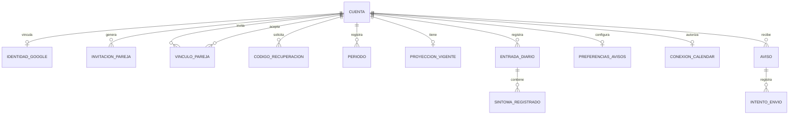

# Lunara · Diseño y decisiones

Este documento reúne los acuerdos de Lunara, los contratos que estamos definiendo y las preguntas pendientes. Los contratos se completan a medida que se discute cada microservicio.

## Alcance y requisitos

Lunara es un backend para registrar el ciclo menstrual y las observaciones del día a día, estimar fechas a partir del historial y recibir recordatorios según las preferencias de la usuaria. La sustentación se prepara con **una colección de Postman por microservicio**. Gmail y Google Calendar sirven para comprobar los resultados de las integraciones.

El [enunciado de FRANK](Proyecto%20con%20core%20espec%C3%ADfico.txt) exige al menos tres microservicios, una sola base de datos, un sistema de notificaciones, **al menos cinco APIs fuera del CRUD por microservicio**, **80 % de cobertura unitaria**, consumo de al menos dos APIs externas y el proyecto desplegado. Con los cuatro servicios elegidos, eso significa **un mínimo de 20 APIs de negocio**, además de las operaciones de registro, login y CRUD que necesite el sistema. Se pueden incluir más operaciones de negocio.

El artículo incluirá fundamento teórico y tecnológico, justificación de SOLID y del diseño, metodología, MER y diagrama de arquitectura, resultados de despliegue, métricas y anexos de carga y estrés, conclusión y referencias.

## Arquitectura e infraestructura

| Decisión | Diseño acordado o propuesto |
| --- | --- |
| Aplicaciones | Cuatro aplicaciones Spring Boot independientes en Java, siguiendo la referencia de clase. |
| Persistencia | Una sola base PostgreSQL llamada `lunara`. El Compose local crea los esquemas `cuenta`, `ciclo`, `diario` y `notificaciones` y un usuario separado con acceso a su esquema. Los cuatro servicios aplican sus migraciones con Flyway. |
| Comunicación | Cada servicio consulta sus propias tablas directamente. Las llamadas HTTP entre servicios se reservan para operaciones de negocio de otro servicio, como programar un aviso. La validación del token se hace localmente. |
| Autenticación | Cuenta y acceso implementa el login con correo y clave, valida la contraseña con BCrypt y emite un JWT firmado de Lunara. El login opcional con Google también emite un JWT de Lunara. Cada servicio valida el JWT localmente. |
| Postman | Las cuatro colecciones pueden usar el mismo entorno y leer el token de `{{accessToken}}`. Las peticiones protegidas lo envían como Bearer. |
| Despliegue | AWS. La propuesta inicial es una EC2 con Docker Compose, cuatro contenedores de aplicación y un contenedor PostgreSQL con volumen persistente. El tamaño de EC2 se decide con el presupuesto y las mediciones del conjunto. |
| Zona horaria | `America/Bogota` determina qué día es «hoy» para el ciclo y la programación de los avisos en la primera versión. |

La estructura sigue el patrón de puertos y adaptadores que usan [Auth](../auth/src/main/java/com/ecommerce/auth), [Catálogo](../catalogo/src/main/java/com/ecommerce/catalogo) y [Notification](../notification/src/main/java/com/ecommerce/notification). En cada aplicación, `domain/model` representa los datos del negocio, `domain/usecase` aplica las reglas, `domain/model/gateway` declara los puertos de salida, `application` ensambla los casos de uso y `infraestructure` aloja los controladores, adaptadores y mapeos. El recorrido habitual es **controlador → caso de uso → puerto → adaptador**. [Guía de arquitectura de referencia](CONTEXTO_ARQUITECTURA.md)

## Microservicios e integraciones

| Microservicio | Responsabilidad y datos propios |
| --- | --- |
| **Cuenta y acceso** | Registro, identidad, perfil y vínculo de pareja mediante invitaciones. Administra las credenciales, perfiles, identidades vinculadas e invitaciones. |
| **Ciclo** | Registro de inicios y fines de período, proyecciones y análisis de duraciones. Administra el historial de períodos. |
| **Diario y bienestar** | Registro cotidiano de síntomas, intensidad y observaciones. Usa las entradas para calcular patrones y llama a Ciclo cuando necesita ubicar un registro en el ciclo. |
| **Notificaciones** | Aplica preferencias, permisos y modo discreto. Administra los avisos, su programación y los intentos de envío. Usa las fechas de Ciclo y los permisos de Cuenta y acceso. |

| Integración | Servicio | Función acordada |
| --- | --- | --- |
| OpenAI | Diario y bienestar | Al solicitar un análisis, redacta una explicación a partir de las métricas de síntomas que calcula Lunara y las notas disponibles en las entradas consultadas. Lunara no añade nombres ni identificadores del perfil. |
| Brevo | Notificaciones | Envía correos de bienvenida, avisos del ciclo y códigos de recuperación de contraseña. Para la demo, el destinatario de prueba será el Gmail del equipo. |
| Google Calendar | Notificaciones | Crea eventos para las fechas estimadas del ciclo, previa autorización de la usuaria. Se discutió un calendario compartido de prueba como alternativa para demostrar la integración. |
| Inicio de sesión con Google | Cuenta y acceso | Opción adicional de autenticación. La usuaria vincula Google desde su sesión de Lunara. Luego `POST /api/v1/cuenta/login/google` recibe el ID token de Google, valida su firma, emisor, audiencia y vencimiento, busca la identidad por `sub` y devuelve un token de Lunara. |

La demo de login con Google incluye iniciar sesión en el navegador y volver a Postman. El permiso para crear eventos en Calendar se concede por separado. Keycloak quedó fuera del despliegue. OpenFDA y SMS quedaron fuera del alcance. Pwned Passwords quedó como candidata sin aprobación para esta entrega.

## Ciclo

### Reglas acordadas

- La usuaria registra la fecha de inicio cuando llega el período y lo marca como terminado indicando el último día de sangrado. Solo puede haber un período en curso y debe cerrarse antes de abrir el siguiente.
- Puede corregir el inicio o el fin del último período registrado. Corregir el inicio recalcula la proyección. Corregir el fin actualiza la duración del sangrado. La duración del sangrado incluye ambos días. Del 1 al 5 de diciembre son cinco días.
- El flujo normal registra los períodos a medida que ocurren. La demo usará una cuenta con varios períodos completos precargados como datos de prueba.
- La primera proyección requiere dos fechas de inicio. La duración de un ciclo se mide entre dos inicios consecutivos. Suponemos ciclos regulares y usamos el promedio de hasta los tres intervalos más recientes, redondeado al día entero más cercano. El próximo inicio estimado se obtiene sumando esa duración al último inicio registrado.
- La ovulación estimada se muestra desde la primera proyección y se calcula 14 días antes del próximo inicio estimado.
- Si pasa el día estimado y todavía no se registra un nuevo inicio, Lunara conserva la última proyección e indica cuántos días han pasado. Un nuevo inicio real permite recalcular.

### Modelo de datos inicial de Ciclo

| Entidad propuesta | Qué guarda |
| --- | --- |
| Período | Identificador, cuenta propietaria, fecha de inicio y fecha de fin. El fin se completa al cerrar el período. Si había una estimación para ese inicio, se guarda junto con el registro real para poder compararlos. |
| Proyección vigente | Identificador, cuenta propietaria, fechas estimadas de inicio del próximo período y ovulación, duración de ciclo utilizada y cantidad de intervalos. Notificaciones recibe el identificador y las fechas para programar los avisos. |

Se conserva una sola proyección vigente por usuaria, con identificador estable, y se guarda su fecha estimada junto al inicio real siguiente. Al corregir el inicio se actualiza la proyección vigente en la misma transacción. La comparación conserva la estimación que se tenía antes de registrar ese inicio. Las escrituras de la misma cuenta se serializan para que dos peticiones simultáneas no abran dos periodos.

### Operaciones de registro

Las peticiones usan `Authorization: Bearer {{accessToken}}`. Las fechas se envían como `AAAA-MM-DD`. Se aceptan fechas anteriores hasta hoy si mantienen el orden del historial.

| API | Body y respuesta |
| --- | --- |
| `POST /api/v1/ciclo/periodos/inicio` | Recibe `inicio` y devuelve `201 Created` con `id`, `inicio`, `fin` e `inicioEstimado`. Devuelve `409 PERIODO_EN_CURSO` si hay uno abierto. |
| `PATCH /api/v1/ciclo/periodos/ultimo/fin` | Recibe `fin` y devuelve `200 OK` con el periodo cerrado. Devuelve `409 PERIODO_CERRADO` si ya se cerró. |
| `PATCH /api/v1/ciclo/periodos/ultimo` | Recibe `inicio`, `fin` o ambos, y devuelve `200 OK` con las fechas corregidas. Para indicar el primer fin de un periodo se usa la operación de cierre. |
| `GET /api/v1/ciclo/periodos` | Devuelve una lista del más reciente al más antiguo. Acepta `pagina` desde 0 y `tamano` de 1 a 100, con 20 por defecto. |

Una fecha futura, un fin anterior al inicio o un inicio que se solapa con el periodo previo devuelve `400 FECHAS_INVALIDAS`. Cerrar o corregir sin un periodo registrado devuelve `404 SIN_PERIODOS_REGISTRADOS`.

### Las cinco APIs de negocio

Las cinco rutas están implementadas y operan sobre los datos de la cuenta identificada por el token de Lunara. Se pueden probar con la [colección de Ciclo](../lunara/postman/Ciclo.postman_collection.json) después de hacer login con una cuenta nueva en el entorno local compartido.

| API | Contrato y estado de la decisión |
| --- | --- |
| **1. Proyectar período y ovulación** | `GET /api/v1/ciclo/proyeccion`, con body vacío. Devuelve las dos fechas estimadas y el número de intervalos usados. Con menos de dos inicios devuelve `200 OK`, `HISTORIAL_INSUFICIENTE` y un mensaje que pide completar los registros necesarios. Si ya pasó la fecha estimada, se propone conservar las fechas y devolver `FECHA_ESTIMADA_PASADA` junto con `diasDesdeFechaEstimada`. |
| **2. Consultar el estado actual** | `GET /api/v1/ciclo/estado-actual`, con body vacío. Desde el primer inicio devuelve `diaDelCiclo` y `estadoPeriodo`. El inicio cuenta como día uno y «hoy» usa `America/Bogota`. Por ejemplo, si el inicio fue el 1 y la consulta es el 8, devuelve el día 8. Sin un inicio registrado, se propone devolver `200 OK` con el estado `SIN_PERIODOS_REGISTRADOS`. |
| **3. Resumir los ciclos recientes** | `GET /api/v1/ciclo/resumen` es la ruta propuesta. Muestra hasta tres ciclos completos, del más reciente al más antiguo, con fecha de inicio, duración del ciclo y días de sangrado. Devuelve los ciclos completos disponibles si hay uno o dos y una lista vacía si no hay ninguno. El siguiente inicio registrado permite calcular cuánto duró el ciclo anterior. |
| **4. Comparar la estimación con el inicio real** | Compara únicamente el último período registrado. Ruta propuesta `GET /api/v1/ciclo/comparacion-ultimo-periodo`, con body vacío. Devuelve fecha estimada, inicio real y diferencia en días. Si se estimó para el 28 de enero y empezó el 30, la diferencia es `+2`. Se propone guardar la estimación vigente junto con el nuevo inicio al registrarlo, para conservar la referencia al recalcular. Cuando falta una estimación previa, responde `200 OK` con el estado `SIN_ESTIMACION_PREVIA` y el mensaje «Todavía no hay una fecha estimada para comparar». |
| **5. Simular un adelanto o retraso** | Ruta propuesta `POST /api/v1/ciclo/simular`. Recibe `desplazamientoDias` como un número entero. Un valor positivo retrasa la fecha, uno negativo la adelanta y cero la conserva. La usuaria elige cuántos días simular sin un tope de negocio. La respuesta muestra cómo se moverían el próximo período y el siguiente. Un retraso de tres días mueve una estimación del 28 al 31 de enero. La simulación deja intactos el historial y los avisos. |

Las pruebas del caso de uso usan fechas fijas. Con intervalos de 28, 30 y 32 días, `assertEquals` comprueba los 30 días estimados y ambas fechas. También se cubren historial insuficiente, el día uno en Bogotá, duración inclusiva del sangrado, el signo de la diferencia y la corrección. El simulador comprueba con `verify(..., never())` que no se guardan periodos ni proyecciones.

## Cuenta y acceso

- Cada cuenta puede tener **una sola pareja activa a la vez**. Para establecer otro vínculo, primero debe revocar el anterior.
- La vinculación se inicia con una invitación y la otra persona la acepta desde su propia cuenta de Lunara. El código es de un solo uso y no tiene vencimiento por tiempo. Si la usuaria genera un código nuevo, el código pendiente anterior queda invalidado.
- Al generar la invitación, los permisos `compartirAvisoPeriodo` y `compartirAvisoOvulacion` vienen activos (`true`). La usuaria puede desactivar cualquiera por separado (`false`) al generar la invitación o después de que se active el vínculo.
- Cualquiera de las dos personas puede revocar el vínculo desde su propia cuenta. Al revocarlo, se retira el permiso para compartir avisos de ese vínculo.
- La primera versión accede al diario con el token de Lunara y comprueba que las entradas pertenecen a la cuenta autenticada. El PIN queda fuera del alcance.
- La recuperación de contraseña se hace por correo. La usuaria solicita un código, Notificaciones lo envía por Brevo y luego la usuaria presenta el código junto con la nueva contraseña en una segunda petición a Cuenta y acceso. El código es de un solo uso y vence a los **15 minutos**.
- El login con correo y clave es el punto de entrada para probar las APIs protegidas desde Postman. `POST /api/v1/cuenta/login` recibe `correo` y `clave` en el body JSON y devuelve el token de acceso de Lunara en `accessToken`. El token dura **24 horas en el entorno de pruebas**. Las cuatro colecciones lo usan como Bearer mediante `{{accessToken}}`.

### Cinco APIs propuestas para cubrir el mínimo de negocio

| API | Ruta propuesta | Regla principal |
| --- | --- | --- |
| **1. Generar invitación de pareja** | `POST /api/v1/cuenta/pareja/invitaciones` | Genera un código de un solo uso con los permisos elegidos e invalida el código pendiente anterior. |
| **2. Aceptar invitación de pareja** | `POST /api/v1/cuenta/pareja/aceptar` | Valida el código, activa el vínculo entre dos cuentas diferentes disponibles y consume la invitación. |
| **3. Revocar vínculo de pareja** | `POST /api/v1/cuenta/pareja/revocar` | Permite a cualquiera de las dos cuentas terminar el vínculo y retira el permiso para compartir avisos. |
| **4. Solicitar recuperación de contraseña** | `POST /api/v1/cuenta/recuperacion/solicitar` | Recibe el correo y, cuando corresponde, genera un código con vigencia de 15 minutos y pide a Notificaciones que lo envíe por Brevo. |
| **5. Confirmar recuperación de contraseña** | `POST /api/v1/cuenta/recuperacion/confirmar` | Valida el código, cambia la contraseña y consume el código para impedir que se vuelva a usar. |

Cuenta y acceso también incluye registro, login con correo y clave, login con Google, perfil y edición de permisos de pareja. Los dos métodos de login permiten iniciar una sesión de Lunara y forman parte de la demo. Los contratos iniciales de las cinco operaciones de negocio se detallan a continuación.

### Contrato de registro

- `POST /api/v1/cuenta/registro` recibe `nombre`, `correo` y `clave` como únicos campos obligatorios. En el modelo de datos se propone guardar el correo como único y guardar la clave como hash BCrypt.
- La respuesta implementada es `201 Created` con `id`, `nombre` y `correo`. La cuenta permite iniciar sesión de inmediato. El correo se guarda en minúsculas y un duplicado devuelve `409 CORREO_YA_REGISTRADO`. La clave debe tener al menos ocho caracteres y hasta 72 bytes en UTF-8.
- Tras confirmar el registro, Cuenta solicita por HTTP el correo de bienvenida a Notificaciones. La activación se mantiene independiente del envío.

### Contrato de login con correo y consulta de perfil

- `POST /api/v1/cuenta/login` recibe `correo` y `clave`. Devuelve `200 OK` con `accessToken` y `expiresIn` en segundos (`86400` en el entorno local). Un correo desconocido o una clave incorrecta devuelve el mismo `401 CREDENCIALES_INVALIDAS`.
- `GET /api/v1/cuenta/perfil` requiere `Authorization: Bearer {{accessToken}}` y devuelve `200 OK` con `id`, `nombre` y `correo` de la cuenta identificada por el token. Cuenta valida localmente el JWT RS256, su emisor `lunara`, la audiencia `lunara-api` y el vencimiento. El perfil responde `401` si falta el token o es inválido.
- Los tres endpoints se pueden probar con la [colección de Cuenta](../lunara/postman/Cuenta.postman_collection.json) y el [entorno compartido](../lunara/postman/Lunara-local.postman_environment.json).

### Contrato de vinculación y login con Google

- `POST /api/v1/cuenta/google/vincular` recibe `idToken` en el body y el JWT de Lunara como Bearer. Valida el ID token y asocia su `sub` con la cuenta de esa sesión. Devuelve `204 No Content`, incluso al repetir el mismo vínculo. Si cualquiera de las identidades pertenece a otro vínculo devuelve `409 IDENTIDAD_GOOGLE_EN_USO`.
- `POST /api/v1/cuenta/login/google` recibe `idToken` y se usa sin sesión de Lunara. Busca el vínculo por `sub`. Devuelve `200 OK` con `accessToken` y `expiresIn` para los cuatro servicios. Una identidad sin vínculo devuelve `403 GOOGLE_NO_VINCULADO`. La vinculación es explícita y el correo de la cuenta se conserva.
- Cuenta verifica la firma con las claves públicas de Google, valida el emisor, la audiencia configurada en `GOOGLE_CLIENT_ID`, el vencimiento, el presentador si aparece y el identificador `sub`. El ID token inválido o vencido devuelve `401 GOOGLE_ID_TOKEN_INVALIDO`. Sin cliente configurado devuelve `503 GOOGLE_NO_CONFIGURADO`.
- Este flujo solicita únicamente la identidad de Google. La autorización de Calendar se configura por separado. [Flujo de Postman](../lunara/README.md#inicio-de-sesión-con-google) · [Verificación de ID tokens de Google](https://developers.google.com/identity/gsi/web/guides/verify-google-id-token).

### Modelo de datos inicial de Cuenta y acceso

| Entidad propuesta | Qué guarda |
| --- | --- |
| Cuenta | Identificador de la usuaria, nombre, correo único y hash de la clave. |
| Identidad de Google | Identificador `sub` de Google y cuenta de Lunara a la que se vinculó. |
| Invitación de pareja | Cuenta que invita, hash SHA-256 del código aleatorio, permisos seleccionados y estado de la invitación. |
| Vínculo de pareja | Cuenta que invitó, cuenta que aceptó, permisos vigentes y fecha de revocación. Una tabla de participantes activos garantiza un solo vínculo por cuenta. |
| Código de recuperación | Cuenta, hash SHA-256 del código aleatorio, fecha de solicitud, vencimiento y momento de uso. Se conserva un registro por cuenta. |

El correo es fijo en la primera versión. Se usa para iniciar sesión, recuperar la contraseña y recibir avisos. El perfil permite editar el nombre.

### Contrato de generación de invitaciones

- `POST /api/v1/cuenta/pareja/invitaciones` requiere el token de Lunara. El body puede incluir `compartirAvisoPeriodo` y `compartirAvisoOvulacion`. Si se omite un permiso, se aplica `true`.
- Devuelve `201 Created` con `codigo`. El código tiene 32 caracteres y se devuelve al crear la invitación. Una invitación nueva invalida la anterior si estaba pendiente. Si la cuenta ya tiene un vínculo activo, la respuesta es `409 VINCULO_ACTIVO`.
- La usuaria copia el código y se lo comparte directamente a su pareja.

### Contrato de aceptación de invitaciones

- `POST /api/v1/cuenta/pareja/aceptar` requiere el token de la cuenta que recibió el código y recibe `codigo` en el body JSON. Si el código es válido y ambas cuentas están disponibles para vincularse, crea el vínculo y consume el código en la misma operación.
- Devuelve `200 OK` con `idVinculo`, `compartirAvisoPeriodo` y `compartirAvisoOvulacion`. Un código usado, reemplazado o desconocido devuelve `400 INVITACION_INVALIDA`. Intentar aceptar el código propio devuelve `400 INVITACION_PROPIA`. Si cualquiera de las dos cuentas ya tiene un vínculo, devuelve `409 VINCULO_ACTIVO`.
- Los avisos se comparten en una sola dirección. Quien acepta recibe únicamente los avisos autorizados por quien generó la invitación.
- Al aceptar se consume el código y se invalida cualquier invitación que la segunda cuenta tuviera pendiente. Cuenta bloquea ambas filas en la misma transacción para aplicar estas reglas aunque haya solicitudes simultáneas.

### Contrato de edición de permisos

- `PATCH /api/v1/cuenta/pareja/permisos` requiere el token de quien generó la invitación. El body incluye `compartirAvisoPeriodo`, `compartirAvisoOvulacion` o ambos. Los permisos omitidos conservan su valor.
- Devuelve `200 OK` con `idVinculo` y los dos permisos vigentes. Quien aceptó la invitación recibe `403 PERMISOS_RESERVADOS_AL_TITULAR` si intenta modificarlos. Si no hay vínculo activo devuelve `404 SIN_VINCULO_ACTIVO`.

### Contrato de revocación del vínculo

- `POST /api/v1/cuenta/pareja/revocar` requiere el token de cualquiera de las dos cuentas vinculadas y lleva el body vacío. Termina el vínculo activo, retira los permisos asociados y devuelve `204 No Content`. Una cuenta sin vínculo activo recibe `404 SIN_VINCULO_ACTIVO`.
- Una vez confirmada la revocación, Cuenta solicita a Notificaciones que cancele los correos pendientes del vínculo. Notificaciones también verifica el vínculo antes de cada envío. Cuenta deja ambos participantes libres para vincularse nuevamente.

### Contrato de solicitud de recuperación de contraseña

- `POST /api/v1/cuenta/recuperacion/solicitar` recibe `correo` en el body JSON y se usa antes de iniciar sesión. Con un proveedor de correo configurado, devuelve `202 Accepted` y el mismo campo `mensaje` para un correo conocido, desconocido o solicitado nuevamente en menos de un minuto.
- Si la cuenta existe y ya pasó el intervalo de un minuto, Cuenta genera un código aleatorio de 32 caracteres, sustituye cualquier código anterior y guarda el hash con 15 minutos de vigencia. Entrega el código al adaptador de correo después de confirmar la transacción.
- Cuenta solicita el envío por HTTP a Notificaciones. El perfil `correo-local` de Notificaciones usa Mailpit. En el entorno con Brevo se usa el adaptador transaccional. Si Cuenta carece de credencial interna, solicitar devuelve `503 RECUPERACION_NO_CONFIGURADA` para cualquier correo. [Flujo local en Postman](../lunara/README.md#recuperación-con-correo-local).

### Contrato de confirmación de recuperación

- `POST /api/v1/cuenta/recuperacion/confirmar` recibe `correo`, `codigo` y `nuevaClave` en el body JSON y se usa antes de iniciar sesión. Si el código corresponde al correo, sigue vigente y está sin usar, Cuenta guarda la nueva clave con BCrypt y consume el código en una sola transacción. Devuelve `204 No Content`. Si el código es incorrecto, expiró o ya se usó, devuelve `400 CODIGO_RECUPERACION_INVALIDO`.
- Después de la recuperación, la usuaria puede iniciar sesión con la nueva clave y obtener otro token. Para la demo, los tokens emitidos anteriormente conservan su fecha original de vencimiento. La revocación inmediata queda para después de la demo.

### Validación del token para la demo

- Los dos métodos de login devuelven en `accessToken` un JWT firmado por Cuenta y acceso. En Postman se envía como `Authorization: Bearer {{accessToken}}`. La vigencia de 24 horas se conserva para el entorno de pruebas.
- Cada microservicio usa la clave pública configurada para comprobar la firma del JWT, valida el emisor, la audiencia y el vencimiento, y toma del token el identificador de la cuenta. Un token inválido o vencido produce `401 Unauthorized`. La validación se resuelve dentro de cada servicio.
- Las rutas internas de Cuenta y Notificaciones requieren `X-Lunara-Interno`. Las APIs de usuaria usan el JWT habitual. La exposición de puertos y el transporte en AWS se definirán con el despliegue.

### Escenarios de prueba de Cuenta y acceso

| Operación | Comprobación esperada |
| --- | --- |
| Registro, login y lectura de perfil | `assertEquals` comprueba el correo normalizado, el hash que llega al gateway y el token devuelto. `assertThrows` comprueba los casos de correo repetido o credenciales incorrectas. `verify(..., never())` comprueba que se evita guardar duplicados o emitir un token si falla el login. |
| Vincular e iniciar sesión con Google | `verify` comprueba que el caso de uso consulta el `sub` verificado y emite el JWT de la cuenta vinculada. `assertThrows` comprueba que se rechazan identidades sin vínculo y conflictos. El adaptador se prueba con JWT firmados en un proveedor local de claves. |
| Generar otra invitación | `assertEquals` comprueba los permisos del código nuevo. `assertThrows` comprueba que el código pendiente anterior ya no se puede aceptar. |
| Aceptar una invitación | `assertEquals` comprueba la relación entre ambas cuentas y los permisos concedidos. `assertThrows` comprueba que el mismo código se rechaza al intentar usarlo de nuevo. |
| Revocar el vínculo | `verify` comprueba que se revoca el identificador correcto. La prueba HTTP verifica que los avisos pendientes dejan de estar activos y la pareja no recibe el correo. |
| Editar permisos de pareja | `assertEquals` comprueba que un permiso omitido conserva su valor. `assertThrows` y `verify(..., never())` comprueban que quien aceptó la invitación no puede habilitar avisos de la otra cuenta. |
| Solicitar recuperación | `assertEquals` comprueba que el mensaje es el mismo con un correo conocido y uno desconocido. `verify(..., never())` comprueba que no se pide un envío para un correo desconocido. |
| Confirmar recuperación | `assertThrows` comprueba el rechazo de un código vencido o usado. `verify(..., never())` comprueba que la clave no cambia en esos casos. Desde Postman se comprueba que se puede iniciar sesión con la nueva clave y que se rechaza la anterior. |

## Diario y bienestar

- El diario es opcional. Cada usuaria puede tener **hasta una entrada editable por día**, con varios síntomas y una nota opcional. El día se determina con `America/Bogota`.
- Un día en el que la usuaria decide no registrar nada queda **sin entrada**. El seguimiento puede mostrarlo como un día sin registro y el análisis trabaja con lo que sí está registrado. Un día sin entrada no se interpreta como un día sin síntomas.
- Cada entrada nueva se registra para el día actual en `America/Bogota`. El backend asigna esa fecha. Los días que quedaron sin entrada se mantienen así.
- Una entrada solo se puede editar durante el día en que se creó, según `America/Bogota`. Desde el día siguiente queda disponible para consulta y análisis.
- Cada síntoma tiene su propia intensidad, expresada como un entero de **1 a 5**. `1` significa leve y `5` significa muy intenso.
- La primera versión usa el catálogo fijo `COLICOS`, `DOLOR_DE_CABEZA`, `HINCHAZON`, `FATIGA` y `SENSIBILIDAD_EN_SENOS`. Cada síntoma se registra una vez por día. Las observaciones adicionales se escriben en la nota, que admite hasta 1000 caracteres.
- Se puede guardar una entrada con solo una nota. Para guardarla, debe tener una nota con texto o al menos un síntoma.
- Al pedir un resumen o análisis, Diario usa toda la información disponible en las entradas del período consultado. Si solo hay síntomas, usa sus métricas. Si solo hay notas, usa las notas. Cuando hay ambos, usa ambos. Una nota permite resumir lo observado ese día. Los patrones entre ciclos requieren datos de varios registros.
- La usuaria elige un rango inclusivo de hasta 366 días con `desde` y `hasta`. Si indica la misma fecha en ambos campos, se consulta solo ese día.
- Para cada síntoma, Diario calcula en cuántos días del rango se registró y su intensidad promedio en esos días. Por ejemplo, intensidades `2`, `3` y `4` en tres días dan un promedio de `3`.

### Operaciones base de las entradas

- `POST /api/v1/diario/entradas` recibe `sintomas` como lista de objetos con `sintoma` e `intensidad`, y `nota` como texto. Al menos uno de los dos debe aportar contenido. El JWT determina la cuenta y el reloj de Bogotá determina la fecha. Devuelve `201` con `id`, `fecha`, `sintomas` y `nota`. Para una segunda entrada del día devuelve `409 ENTRADA_YA_REGISTRADA`.
- `PATCH /api/v1/diario/entradas/{entradaId}` actualiza la nota, los síntomas o ambos. Los campos omitidos se conservan. Una cadena vacía quita la nota y una lista vacía quita los síntomas, siempre que la entrada conserve contenido. Devuelve `200`, `409 EDICION_FUERA_DEL_DIA` para una entrada anterior o `404 ENTRADA_NO_ENCONTRADA` si el identificador no pertenece a la cuenta.
- `GET /api/v1/diario/entradas?desde=AAAA-MM-DD&hasta=AAAA-MM-DD` devuelve `200` y las entradas propias ordenadas por fecha. Las entradas anteriores se conservan y están disponibles para consultar o analizar.

### Modelo de datos inicial de Diario y bienestar

| Entidad propuesta | Qué guarda |
| --- | --- |
| Entrada del diario | Identificador, cuenta propietaria, fecha y nota opcional. La combinación de cuenta y fecha es única. |
| Síntoma registrado | Entrada, código de síntoma del catálogo fijo e intensidad de 1 a 5. Una entrada puede contener varios síntomas. |

Cada solicitud genera un análisis con las métricas de síntomas e intensidades y todas las notas del rango. Diario envía métricas agregadas y el día relativo de cada nota a OpenAI Responses, con `store: false`. No añade el perfil, el correo ni identificadores de la cuenta al contenido. El resultado se devuelve en la misma petición y no se almacena en PostgreSQL. Si la usuaria vuelve a pedir el análisis, se genera otra respuesta con el contexto actual. [OpenAI Responses](https://platform.openai.com/docs/api-reference/responses/create).

### APIs de negocio del diario

**1. Analizar el diario con OpenAI.** Contrato propuesto `POST /api/v1/diario/analisis`, con el token de Lunara y los campos `desde` y `hasta` en el body JSON. Diario calcula las métricas, las usa junto con las notas disponibles y devuelve el texto redactado por OpenAI en el campo `analisis`. Para un rango sin entradas, se propone responder `200 OK` con el estado `SIN_REGISTROS` y omitir la llamada a OpenAI.

En la prueba unitaria, `assertEquals` comprueba los tres días y la intensidad promedio de `3` en el ejemplo anterior. Para un rango vacío, `assertEquals` comprueba el estado y `verify(..., never())` comprueba que el adaptador de OpenAI no se invoca.

**2. Comparar síntomas entre ciclos.** Contrato propuesto `GET /api/v1/diario/comparacion-ciclos`, con el token de Lunara y el body vacío. Diario consulta a Ciclo para obtener los dos ciclos completos más recientes de la usuaria. Devuelve cuántos días se registró cada síntoma y su intensidad promedio en cada ciclo. Con menos de dos ciclos completos, se propone devolver `200 OK` con el estado `HISTORIAL_INSUFICIENTE`.

**3. Consultar en qué días del ciclo se repite un síntoma.** Diario ubica las entradas del síntoma elegido en el día correspondiente de cada ciclo y cuenta sus apariciones. Por ejemplo, si los cólicos se registraron el día uno en dos ciclos, la respuesta muestra dos apariciones en el día uno. Se propone `GET /api/v1/diario/sintomas/patron-por-dia?sintoma=COLICOS` y usar hasta los tres ciclos completos más recientes.

**4. Exportar un resumen del diario.** La usuaria puede descargar desde Postman un PDF de un rango elegido con las fechas, los síntomas y las intensidades registradas. El PDF se genera en Diario y las notas personales quedan fuera. Contrato propuesto `GET /api/v1/diario/exportacion?desde=AAAA-MM-DD&hasta=AAAA-MM-DD`, con el token de Lunara y respuesta `application/pdf`.

**5. Calcular el seguimiento del diario.** Para un rango inclusivo de fechas, Diario cuenta cuántos días tienen alguna entrada y señala qué fechas quedaron sin registro. Una nota sola también cuenta como una entrada válida. Por ejemplo, en una semana con cinco entradas, devuelve cinco días registrados y dos fechas sin entrada. Contrato propuesto `GET /api/v1/diario/seguimiento?desde=AAAA-MM-DD&hasta=AAAA-MM-DD`, con el token de Lunara.

Para las otras APIs del diario, `assertEquals` comprueba las métricas de los dos ciclos, las apariciones por día del ciclo y las fechas sin entrada en el seguimiento. En la exportación, `verify` comprueba que el generador del PDF recibe fechas, síntomas e intensidades. Un caso con una nota personal comprueba que esa nota queda fuera del reporte.

Las cinco APIs están implementadas. Diario consulta `GET /api/v1/ciclo/resumen` por HTTP con el JWT original para comparación y patrones. OpenAI se invoca solo para rangos con entradas y devuelve un resumen descriptivo. Si falta la configuración, la petición con entradas devuelve `503 OPENAI_NO_CONFIGURADO`. [Colección de Diario](../lunara/postman/Diario.postman_collection.json).

## Notificaciones

Los avisos del período y de la ovulación se programan a las **8:00 a. m. en `America/Bogota`**, el día estimado correspondiente.

- Cuando Ciclo calcula una proyección al registrar un inicio, Notificaciones programa automáticamente los avisos en los canales que la usuaria tenga activos. El correo queda pendiente en Lunara hasta su fecha de envío. El evento de Google Calendar se crea con el recordatorio para la fecha y hora previstas.
- Al programar una proyección, se omiten los avisos cuya fecha y hora ya hayan pasado, incluido un aviso para hoy cuando ya pasaron las 8:00 a. m. La regla se aplica al crear el aviso. Los avisos que ya estaban programados se procesan cuando les corresponde.
- Si una corrección cambia la proyección, Notificaciones mueve el correo pendiente y actualiza el mismo evento de Google Calendar a la nueva fecha. Para hacerlo, conserva el identificador del evento de Google.
- La pareja recibe por correo los avisos que le autorizó la usuaria. Google Calendar se usa para los recordatorios personales de quien registra su ciclo.
- Un fallo temporal admite dos reintentos, con cinco minutos entre intentos, para un total de tres intentos. Si se agotan, el aviso queda como fallido. Un fallo definitivo se registra como fallido desde el primer intento.
- Al desactivar un canal, Lunara cancela sus avisos futuros. Los correos todavía pendientes se cancelan en Lunara. Para Google Calendar, Lunara retira los eventos futuros que creó mientras conserve el permiso para hacerlo.

### Modelo de datos inicial de Notificaciones

| Entidad propuesta | Qué guarda |
| --- | --- |
| Preferencias de avisos | Cuenta, canales activos y modo discreto. |
| Conexión con Google Calendar | Cuenta, autorización cifrada para el calendario principal, preferencia de activación y estado de sincronización. |
| Aviso | Cuenta, destinatario, tipo de aviso, canal, proyección asociada cuando corresponda, fecha programada y estado. Para Calendar guarda el identificador del evento de Google. |
| Intento de envío | Aviso asociado, fecha, número de intento, resultado e identificador del proveedor cuando esté disponible. |

Los avisos y sus intentos se conservan para controlar el envío, las cancelaciones y los reintentos. El historial de avisos se usa internamente y queda fuera de las APIs de la usuaria.

Los avisos del período estimado y la ovulación estimada por correo quedan activos al crear la cuenta. La usuaria puede desactivar ese canal desde sus preferencias. La bienvenida y la recuperación de contraseña se disparan con sus propias operaciones.

El modo discreto viene desactivado por defecto (`modoDiscreto = false`). Los avisos muestran si corresponden al período estimado o a la ovulación estimada. La usuaria puede activar el modo discreto desde sus preferencias para usar el título y el texto neutros en correo y Google Calendar.

Si la usuaria conecta Google Calendar cuando ya tiene una proyección, Lunara crea de inmediato los eventos de esa proyección cuya fecha y hora todavía no hayan pasado. Se reutiliza el evento si ya existe para evitar duplicados.

Al activar o desactivar el modo discreto, Notificaciones aplica la nueva preferencia a los correos pendientes y actualiza el título de los eventos futuros que ya creó en Google Calendar.

### Avisos ya acordados

| Momento | Brevo | Google Calendar |
| --- | --- | --- |
| Día estimado de inicio del período | Correo si está activado. | Evento con aviso si Calendar está activado. |
| Día estimado de ovulación | Correo si está activado. | Evento con aviso si Calendar está activado. |
| Registro exitoso de la cuenta | Correo de bienvenida. | — |

Cuenta y acceso confirma el registro y pide la bienvenida a Notificaciones por HTTP. Ciclo calcula las fechas y Notificaciones programa los avisos según las preferencias de la usuaria. En **modo discreto**, el evento, el asunto y el texto del correo se mantienen neutros. El título acordado para los avisos del ciclo es **«Recordatorio personal»**. La pareja solo puede recibir los tipos de aviso que la usuaria le haya autorizado.

### Cinco APIs de negocio acordadas para Notificaciones

| API | Ruta propuesta | Regla principal |
| --- | --- | --- |
| **1. Programar avisos de una proyección** | `POST /api/v1/notificaciones/interno/avisos/programar` | Ciclo informa las fechas estimadas. Notificaciones aplica preferencias y permisos, deja los correos pendientes y crea los eventos de Calendar para las 8:00 a. m. |
| **2. Reprogramar los avisos** | `POST /api/v1/notificaciones/interno/avisos/reprogramar` | Al cambiar una proyección, reemplaza la fecha de envío del correo pendiente y modifica el evento de Google existente. |
| **3. Previsualizar un aviso** | `POST /api/v1/notificaciones/avisos/previsualizar` | La usuaria obtiene el título y, cuando corresponde, el asunto y cuerpo que se usarían según el tipo, el canal y el modo discreto. La previsualización solo devuelve el texto. |
| **4. Despachar avisos pendientes** | `POST /api/v1/notificaciones/interno/avisos/despachar` | Procesa avisos cuyo horario ya llegó, vuelve a comprobar preferencias y permisos y registra el resultado del proveedor. |
| **5. Procesar reintentos** | `POST /api/v1/notificaciones/interno/avisos/reintentar` | Procesa los fallos temporales cuyo plazo de espera ya pasó, respeta los dos reintentos y registra el resultado definitivo. |

### Contratos disponibles en Notificaciones

| API | Contrato |
| --- | --- |
| `GET /api/v1/notificaciones/preferencias` | Usa el JWT de Lunara. Devuelve `200` con `correoActivo` y `modoDiscreto`. Los valores iniciales son `true` y `false`. |
| `PATCH /api/v1/notificaciones/preferencias` | Usa el JWT de Lunara. Recibe uno o ambos campos y devuelve `200` con los valores guardados. |
| `POST /api/v1/notificaciones/avisos/previsualizar` | Usa el JWT y recibe `tipo` (`PERIODO` u `OVULACION`) y `canal` (`CORREO` o `CALENDAR`). Devuelve `200` con `titulo`, `asunto` y `texto`; Calendar devuelve `asunto: null`. |
| `POST /api/v1/notificaciones/interno/correos/bienvenida` | Requiere la credencial interna. Recibe `correo` y devuelve `204` si el proveedor acepta el envío. |
| `POST /api/v1/notificaciones/interno/correos/recuperacion` | Requiere la credencial interna. Recibe `correo` y `codigo`. Devuelve `204` si el proveedor acepta el envío o `503 CORREO_NO_DISPONIBLE` si falla. |

Cuenta despacha bienvenida y recuperación en segundo plano. El registro conserva su `201` y la recuperación su `202` si falla la entrega posterior. La previsualización usa las preferencias guardadas y solo redacta el contenido. [Colección de Notificaciones](../lunara/postman/Notificaciones.postman_collection.json).

### Contratos de agenda de correo

| Operación interna | Body y resultado |
| --- | --- |
| `POST /api/v1/notificaciones/interno/avisos/programar` y `POST /api/v1/notificaciones/interno/avisos/reprogramar` | Reciben `usuarioId`, `proyeccionId`, `version`, `fechaPeriodoEstimada` y `fechaOvulacionEstimada`. Devuelven `204`, también si la versión es repetida o anterior. |
| `POST /api/v1/notificaciones/interno/avisos/despachar` | Body vacío. Procesa hasta 20 correos pendientes cuya hora llegó y devuelve `200` con cantidades por resultado, como `{"ENVIADO":1}`. |
| `POST /api/v1/notificaciones/interno/avisos/reintentar` | Body vacío. Procesa hasta 20 reintentos cuya espera terminó y devuelve `200` con cantidades por resultado, como `{"REINTENTO":1}`. |
| `POST /api/v1/notificaciones/interno/avisos/pareja/cancelar` | Recibe `titularId` y `vinculoId`. Consulta el estado vigente en Cuenta, cancela los avisos de los tipos revocados y devuelve `204`. |

Ciclo guarda cada cambio de proyección y su versión pendiente de entrega en una sola transacción. Un proceso publica por HTTP la última versión de cada cuenta. Si Notificaciones no responde, la proyección sigue disponible en Ciclo y la publicación vuelve a intentarse.

Notificaciones crea los correos futuros para las 8:00 a. m. de Bogotá y conserva un aviso pendiente que ya estaba programado si la fecha se mantiene. Si cambia la fecha, cancela el aviso anterior y agenda el nuevo. Antes del envío consulta las preferencias locales y los permisos de pareja vigentes en Cuenta. El modo discreto se aplica al redactar el correo. Reactivar el correo permite agendar los avisos de la siguiente actualización de la proyección.

El despachador automático ejecuta las mismas operaciones que las rutas internas. Registra cada intento y conserva la referencia que devuelve Brevo cuando está disponible. Los fallos temporales se reintentan después de cinco minutos, hasta dos veces. Los definitivos se cierran en el primer fallo.

### Contratos de Google Calendar

| Operación | Body y resultado |
| --- | --- |
| `POST /api/v1/notificaciones/calendar/autorizacion` | JWT de Lunara y body vacío. Devuelve `200` con `authorizationUrl` para abrir en el navegador. |
| `GET /api/v1/notificaciones/calendar/callback` | Google envía `state` y `code`. Completa la conexión y devuelve `200 CALENDAR_CONECTADO`. El estado dura diez minutos y es de un solo uso. La autorización se vincula a la cuenta que generó la URL. |
| `GET /api/v1/notificaciones/calendar` | JWT de Lunara. Devuelve `200` con `conectado`, `activo` y `estado` de sincronización. |
| `PATCH /api/v1/notificaciones/calendar` | JWT de Lunara. Recibe `activo` y devuelve `202`. Desactivar retira los eventos futuros de Lunara y conserva el permiso para reactivar. |
| `DELETE /api/v1/notificaciones/calendar` | JWT de Lunara y body vacío. Devuelve `202`. Retira los eventos futuros que aún pueda modificar y elimina la autorización guardada en Lunara. |

El consentimiento de Calendar usa OAuth con PKCE y el permiso `calendar.events.owned`. Lunara guarda cifrado el token de renovación. Al conectar o reactivar, Notificaciones usa la última proyección que recibió de Ciclo y crea solo eventos futuros. Los eventos se crean como privados, sin invitados, con recordatorio emergente a las 8:00 a. m. de Bogotá. Una corrección mueve el mismo evento si todavía es futuro. Al cambiar el modo discreto se actualizan título y texto.

La sincronización corre en segundo plano. Las respuestas `202` indican que el cambio quedó solicitado. Consultar `GET /calendar` permite distinguir `PENDIENTE`, `SINCRONIZADO`, `REQUIERE_AUTORIZACION` y `FALLIDO`. Si el permiso ya se retiró desde Google, puede ser necesario borrar manualmente eventos que Lunara ya no puede modificar. [Flujo de Postman](../lunara/README.md#google-calendar-en-postman) · [Permisos de Google Calendar](https://developers.google.com/workspace/calendar/api/auth).

### Escenarios de prueba de Notificaciones

| Operación | Comprobación esperada |
| --- | --- |
| Programar | `assertEquals` comprueba que la fecha programada corresponde a las 8:00 a. m. en `America/Bogota`. `verify(..., never())` comprueba que se omite el proveedor del canal desactivado. |
| Reprogramar | `assertEquals` comprueba la nueva fecha del correo pendiente. `verify` comprueba que se actualiza el mismo identificador de Calendar. |
| Previsualizar | `assertEquals` comprueba el título «Recordatorio personal» y el texto neutro en modo discreto. `verify(..., never())` comprueba que no se envía ningún aviso. |
| Despachar | `verify` comprueba que se envía el aviso pendiente cuya hora ya llegó. `verify(..., never())` comprueba que se omite un aviso de pareja cuyo permiso se revocó. |
| Reintentar | `assertEquals` comprueba los cinco minutos de espera y el estado fallido al agotar el tercer intento. `verify(..., never())` comprueba que no se reintenta un fallo definitivo. |

En la prueba del flujo entre Ciclo y Notificaciones, se simula un fallo al solicitar la programación y se comprueba que el período y su proyección siguen disponibles desde Ciclo.

## Borrador del MER lógico

Las entidades se reparten entre los cuatro servicios dentro de la misma base PostgreSQL. Las relaciones entre servicios del diagrama representan referencias por identificador. Cada servicio conserva la propiedad de sus datos y consulta al servicio dueño por HTTP cuando necesita una de sus operaciones.

Las reglas principales del modelo son **una pareja activa**, **un período en curso**, **una proyección vigente** y **una entrada de diario por fecha**, todas por cuenta. Cada vínculo identifica por separado a quien invitó y a quien aceptó.

## Preparación de la demo en Postman

La base de pruebas tendrá los datos ficticios precargados para recorrer los cuatro microservicios desde Postman. La preparación se podrá repetir en local y en el entorno de demo de AWS.

| Servicio | Datos precargados para la demo |
| --- | --- |
| Cuenta y acceso | Dos cuentas de prueba disponibles para iniciar sesión y demostrar la invitación, aceptación y revocación del vínculo. Se parte con las cuentas desvinculadas. |
| Ciclo | Varios períodos completos, una estimación previa para comparar con el último inicio real y una proyección vigente que permita mostrar próximos avisos. |
| Diario y bienestar | Síntomas con distintas intensidades y notas ficticias repartidas entre los ciclos precargados. El día de la demo queda disponible para crear y editar una entrada en vivo. |
| Notificaciones | Preferencias de la cuenta de demo y avisos de prueba con los estados necesarios para mostrar programación y reintentos. |

El script `demo/precargar.py` crea dos cuentas de prueba, cuatro periodos completos y nueve entradas ficticias. Las fechas se calculan en relación con el día de la sustentación. Ciclo genera la proyección vigente, que deja avisos futuros al preparar la demo cerca de la fecha elegida. El ambiente de Postman exportado queda en `.local`. Los estados de error y reintento se prueban aparte para que la precarga no genere envíos vencidos. El token de acceso, los códigos de invitación o recuperación y el análisis del diario se generan al ejecutar cada flujo. [Precarga de la demo](../lunara/README.md#precargar-la-demo).

El recorrido principal de Postman empieza con el login de la cuenta de prueba. Después consulta la proyección, compara ciclos, crea la entrada del día, solicita el análisis con OpenAI y verifica los recordatorios. La vinculación de pareja se demuestra con las dos cuentas. El correo de bienvenida se prueba al registrar una cuenta de demostración durante la prueba de registro.

## Pruebas y ruta de trabajo

Los casos de uso se probarán con **JUnit 5 y Mockito** en el estilo de [las pruebas de Auth](../auth/src/test/java/com/ecommerce/auth/domain/usecase/UsuarioUseCaseSaldoTest.java) y la [guía de pruebas](Guia-de-pruebas.md). Usaremos bloques **Arrange / Act / Assert**, `assertEquals` para valores, `assertThrows` para errores de negocio y `verify` o `verify(..., never())` para comprobar efectos relevantes. Por ejemplo, si un canal está desactivado, la prueba verifica que el adaptador de ese proveedor no recibe el envío.

Cuenta pasó 40 pruebas automatizadas y 29 aserciones en su colección de Postman. Las pruebas HTTP usaron PostgreSQL, el buzón local y un proveedor de claves de prueba para Google. El JWT emitido tras el login con Google se comprobó en Cuenta y Ciclo. Dos intentos simultáneos de registrar el mismo correo devolvieron `201` y `409`. Dos intentos de aceptar un código de pareja devolvieron `200` y `400`. La recuperación rechazó códigos vencidos, devolvió `204` y `400` en dos confirmaciones simultáneas y conservó la vigencia del token anterior. La cobertura de la entrega se medirá en la fase de verificación.

Ciclo pasó 15 pruebas unitarias y las 22 peticiones de su colección contra PostgreSQL con un token emitido por Cuenta. La prueba HTTP con dos cuentas confirmó que cada una conserva su propio historial. Dos intentos simultáneos de abrir un periodo para una misma cuenta devolvieron `201` y `409`.

La integración de Notificaciones verificó contra PostgreSQL y Mailpit la publicación diferida cuando el servicio estaba caído, la agenda a las 8:00 a. m., la reprogramación sin aceptar una versión vieja y la cancelación al revocar un vínculo. Una prueba con SMTP inaccesible comprobó que el intervalo registrado era de cinco minutos y que el tercer fallo cerraba el aviso.

Calendar pasó siete pruebas del caso de uso y una prueba HTTP contra PostgreSQL y un proveedor simulado. Esta última verificó el canje OAuth con PKCE y estado de un solo uso, la creación de dos eventos privados, el ajuste de fechas sin duplicados, el modo discreto y el retiro y reactivación de eventos. Falta la prueba de consentimiento y entrega con la cuenta de Google de la demo.

Diario pasó 16 pruebas automatizadas y las 11 comprobaciones de Postman con PostgreSQL, Ciclo real y OpenAI simulado. Dos altas simultáneas para el mismo día devolvieron `201` y `409`. Se comprobó el aislamiento entre cuentas, el rechazo de una edición histórica y la ausencia de notas en el texto extraído del PDF.

1. **Diseño funcional.** Definir al menos cinco APIs fuera del CRUD por servicio y las operaciones de apoyo, empezando por Ciclo. Preparar las pruebas esperadas, el MER y el diagrama de arquitectura.
2. **Base técnica.** Proyectos Maven, PostgreSQL local en Compose, cuatro esquemas con usuarios separados y entorno de Postman creados. Los cuatro servicios ya persisten en PostgreSQL. [Arranque local](../lunara/README.md).
3. **Cuenta y Ciclo.** Registro, login con correo y Google, consulta de perfil, vinculación de pareja y recuperación con correo local implementados en Cuenta. Ciclo tiene registro de periodos y sus cinco operaciones de negocio. Para la demo queda probar Google con el cliente OAuth del equipo.
4. **Notificaciones.** Bienvenida y recuperación, agenda de correo para periodo y ovulación, publicación desde Ciclo, preferencias, previsualización, reintentos, cancelaciones y sincronización con Calendar implementados. El flujo se verificó con Mailpit y proveedores simulados para Brevo y Calendar. Las pruebas con cuentas reales quedan para la demo.
5. **Diario y bienestar.** Entrada del día, edición, historial y cinco operaciones de negocio implementados. Se probó el contrato del proveedor con datos ficticios. Falta la prueba con OpenAI real.
6. **Verificación del sistema.** Se ejecutaron las cuatro colecciones, 364 pruebas unitarias y una prueba local de carga y estrés. JaCoCo midió 91,86 % de líneas cubiertas en casos de uso y 91,67 % en todo el backend, con al menos 89 % en cada servicio. Queda validar los proveedores con las credenciales de la demo. [Resultados de verificación](../lunara/verificacion/RESULTADOS_LOCALES.md).
7. **Despliegue y sustentación.** Probar el flujo completo en AWS y registrar las métricas y resultados en el artículo.
